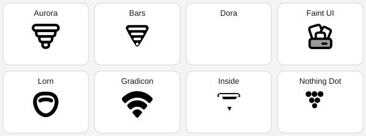
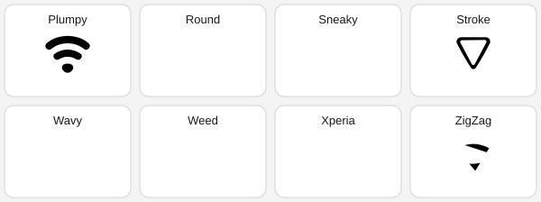
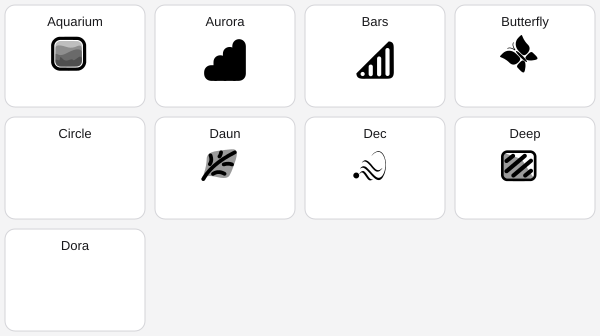
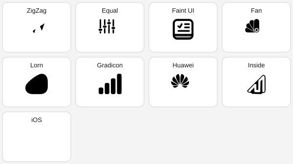
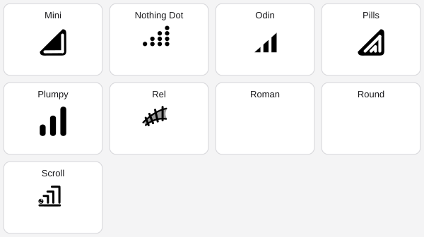
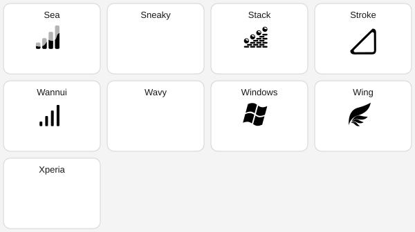

# Iconify status-bar icon gallery

Source: [Mahmud0808/Iconify v7.3.0](https://github.com/Mahmud0808/Iconify/releases/tag/v7.3.0), source commit `ee491e884487959d364f07797c60adcd984ea948`.

The sheets show the **full-strength (level 4) glyph** for every Wi-Fi and cellular style offered in the v7.3.0 selection screens. All 52 preview drawable files used here were checked against the newer inspected source tree; their Git blob hashes are identical. These sheets are converted from Iconify's original Android vector previews for convenient comparison. They are visual references only: final SystemUI size, tint, animation and compatibility on AQUOS R7 must be validated separately.

## Wi-Fi — 16 styles

**Styles 1–8**

**Styles 9–16**

Aurora, Bars, Dora, Faint UI, Lorn, Gradicon, Inside, Nothing Dot, Plumpy, Round, Sneaky, Stroke, Wavy, Weed, Xperia, ZigZag.

## Cellular signal — 36 styles

**Styles 1–9**

**Styles 10–18**

**Styles 19–27**

**Styles 28–36**

Aquarium, Aurora, Bars, Butterfly, Circle, Daun, Dec, Deep, Dora, ZigZag, Equal, Faint UI, Fan, Lorn, Gradicon, Huawei, Inside, iOS, Mini, Nothing Dot, Odin, Pills, Plumpy, Rel, Roman, Round, Scroll, Sea, Sneaky, Stack, Stroke, Wannui, Wavy, Windows, Wing, Xperia.

## Network traffic

Traffic arrows are a separate SystemUI resource family, not another selectable Wi-Fi/cellular style pack in these two Iconify screens. Its original drawable variants and AQUOS R7 mapping remain a separate audit item; they are not included in the 52-style count above.
